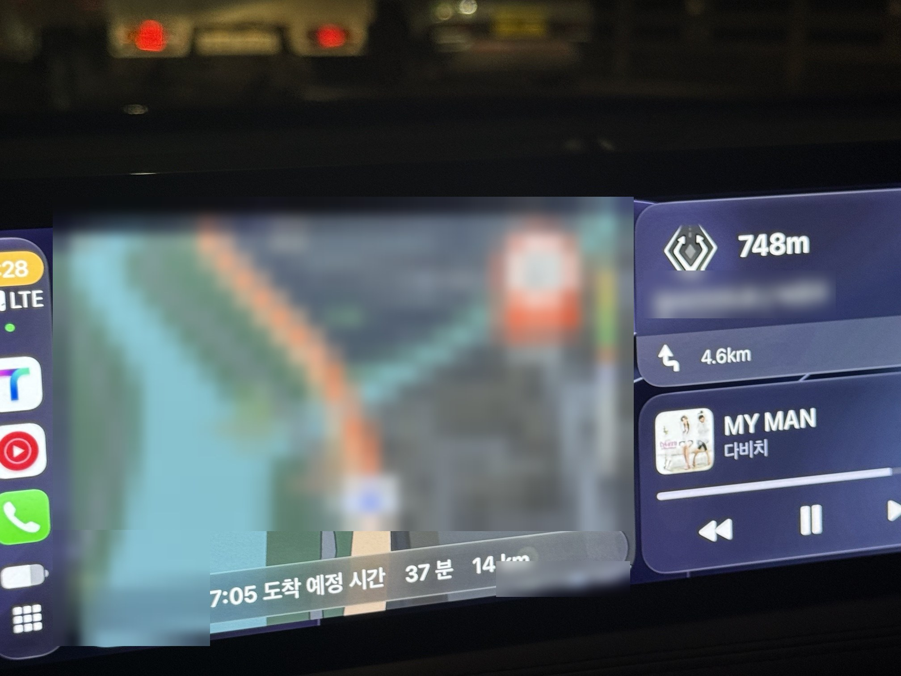
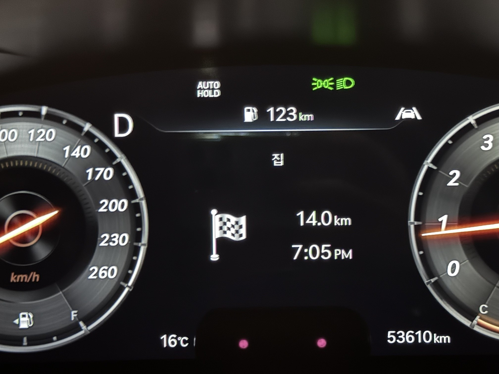
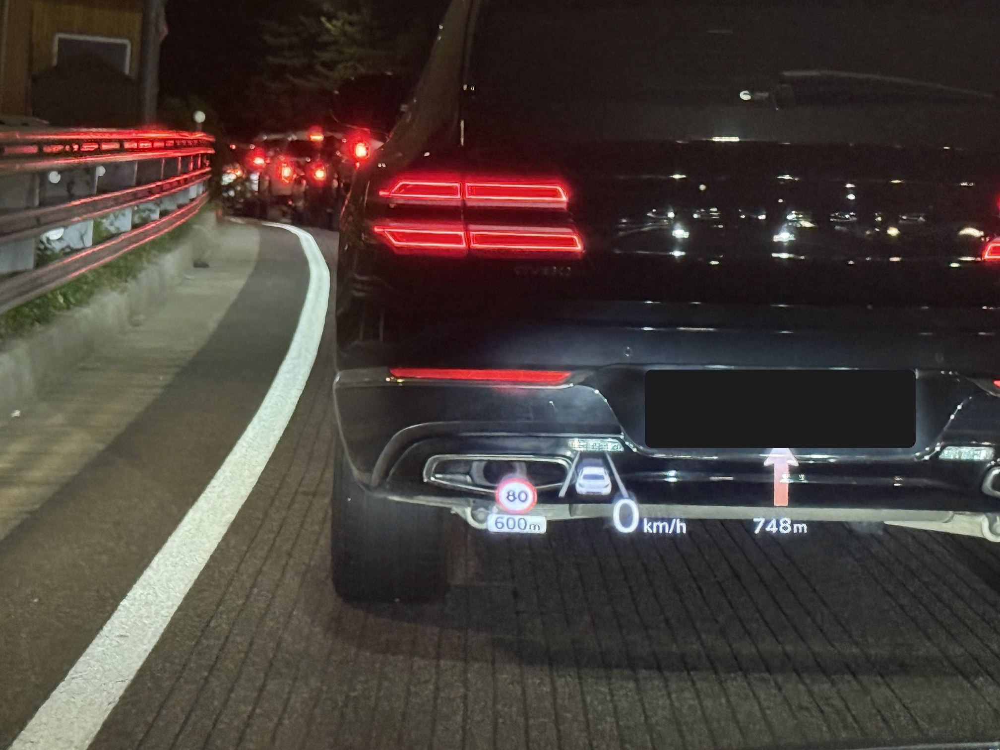

# 제네시스 G70 무선 CarPlay (HMG-API 모드)

국내 **제네시스 G70**(Gen5W 내비게이션, 펌웨어 `IKFL.KOR.0000.V039.001.260902`)에서 아이폰 **무선 CarPlay**와 **HUD·계기판 길안내(TMAP)** 를 쓰기 위한 [HMG-API](https://github.com/Open-HMG/HMG-API) 모드입니다. HMG-API의 공식 모드 "Wireless CarPlay + Android Auto"를 G70에 맞게 바꾼 것입니다.

현재 버전: **2.6.7** ([release/](release/))

> ⚠️ **비공식 자료입니다.** 현대자동차·제네시스·Apple과 관계가 없고, 결과를 보장하지 않습니다. 이 자료로 생긴 고장, 공식 업데이트 실패, 보증·수리 문제는 설치한 사람의 책임입니다. 차 한 대에서만 확인했습니다. 내용을 이해하고 직접 판단해서 사용하세요.

## 지원 차량

| 항목 | 값 |
|---|---|
| 차종 | 국내형 제네시스 G70 (헤드유닛이 Gen5W 내비게이션인 차) |
| 펌웨어 | `IKFL.KOR.0000.V039.001.260902` (설정 → 일반 → SW 정보에서 확인) |
| 폰 | 아이폰 (무선 CarPlay) |

다른 차종이나 다른 펌웨어에는 설치 단계에서 막힙니다. 억지로 넣지 마세요.

## 되는 것과 안 되는 것

2026년 11월, 오너 차량 1대에서 확인한 내용입니다.

| 기능 | 상태 |
|---|---|
| 아이폰 무선 CarPlay (블루투스로 붙고 Wi-Fi로 넘어감) | ✅ 실차 확인 |
| HUD·계기판 길안내 (TMAP): 순정 내비처럼 교차로 그림 + 이름 + 거리 막대 | ✅ 실차 확인 |
| HUD에 회전 이름을 거리와 상관없이 항상 표시 (설정) | ✅ 실차 확인 |
| 음소거하면 CarPlay 음악 일시정지, 풀면 다시 재생 | ✅ 실차 확인 |
| 시동 때 뜨는 동의 화면 자동 닫기 (설정, 기본 꺼짐, P단에서만) | ✅ 실차 확인 |
| 무선에서도 HUD에 곡 정보 표시 | ✅ 실차 확인 |
| TMAP 안내 음성 | ✅ 실차 확인 (2.6.4부터) |
| 통화 (일반·메신저 통화) | ✅ 2.6.7에서 약 1시간 통화 동안 연결 유지 확인 |
| CarPlay 항상 다크 (설정, 기본 꺼짐) | ⚠️ 2.6.7에서 바꾼 방식은 실차 미확인 |
| 애플 지도 길안내 | ⚠️ 초기 버전에서 확인, 이후 TMAP 기준으로만 개발 |
| 무선 Android Auto | ⚠️ 미확인 (공식 모드의 기능은 들어 있음) |
| 계기판·HUD 차선 안내 | ❌ G70 계기판이 그리지 않음 |
| 계기판에 곡 제목·통화 정보 | ❌ G70은 유선 CarPlay에서도 HUD에만 표시 |
| 네이버 지도 길안내 | ❌ 앱이 차로 회전 정보를 보내지 않음 |

알아 둘 점:

- **'HUD 이름 항상'(기본값)이면 계기판에도 다음 안내가 계속 뜨고, 목적지·남은 거리·도착 시간 화면은 가려집니다.** 계기판과 HUD가 같은 신호를 받아서 따로 보낼 수 없습니다. 도착 정보가 필요하면 설정을 `Near only`로 바꾸세요(아래 설정 표).
- 무선 CarPlay는 곡을 넘길 때 유선보다 반응이 느립니다. 무선 방식 자체의 특성입니다.
- 모드는 헤드유닛 안에서만 동작합니다. 주행·안전 장치를 제어하지 않고, 차 밖으로 데이터를 보내지 않습니다.

## 사진

초기 버전(2.1.2) 때 찍은 사진입니다. 지금 버전의 HUD는 화살표 대신 순정 내비처럼 교차로 그림과 이름을 보여줍니다.

| CarPlay 화면 (TMAP) | 계기판 (도착 정보 화면) | HUD |
|---|---|---|
|  |  |  |

## 설치 전 확인

1. **펌웨어 버전.** 차에서 설정 → 일반 → SW 정보를 엽니다. 버전에 `S5W_M`이 들어 있고, 소프트웨어 버전이 `IKFL.KOR.0000.V039.001.260902`이어야 합니다. 다르면 이 자료를 쓰지 마세요.
2. **먼저 지울 것.** 아래가 설치돼 있으면 같은 파일을 건드리므로 먼저 제거합니다.
   - HMG Leafia Plus
   - NEMESIS의 Wireless Projection, Projection TBT
   - 다른 무선 프로젝션 패키지
3. **장소와 시간.** 주차한 상태에서 전원을 켜고 진행합니다. 처음부터 끝까지 30~40분쯤 걸립니다.

## 준비물

- **USB 메모리** (FAT32 또는 exFAT). 단계마다 내용을 바꿔 담으므로 하나면 됩니다.
- **[NEMESIS](https://github.com/xwtk/hmg_nemesis)** 설치 파일 `ota_package.tar`: 헤드유닛에 패키지를 설치하는 도구
- **[HMG-API](https://github.com/Open-HMG/HMG-API/releases)** 의 `hmgapi-<버전>-nemesis.zip`: 모드 관리자
- 이 저장소 [release/](release/)의 파일

| 파일 | 용도 |
|---|---|
| `wireless-carplay-g70-2.6.7.zip` | 모드 (압축을 풀지 않고 사용) |
| `G70-wifi-mark.zip` | Wi-Fi 칩 표시. 모드 설치가 막힐 때만 사용 |
| `G70-hookreset.zip` | 모드가 꺼졌을 때 복구 |
| `G70-hmglog.zip` | 로그 받기 (문제 확인용) |

**확인한 조합:** NEMESIS 1.16.4 + HMG-API 1.0.0-beta.5 (실차). 지금 받을 수 있는 HMG-API 1.0.2는 PC에서 설치·복구 시험만 통과했고(28개 항목) 실차에서는 확인하지 못했습니다. 베타(1.1.0-beta)보다는 정식판(1.0.2)을 권합니다.

## 설치

> **재시작 주의:** 설치 중 헤드유닛을 여러 번 재시작합니다. **재시작한 뒤에는 2분 이상 켜 두고 다음 재시작을 하세요.** 2분 안에 3번 재시작하면 HMG-API가 안전을 위해 모드를 끕니다. 그렇게 됐다면 '문제 해결'의 복구 방법을 따르세요.

### 1단계: NEMESIS 설치

1. `ota_package.tar`를 **압축을 풀지 않고** 빈 USB 최상위에 넣습니다.
2. USB를 차에 꽂습니다. "지원하는 파일 없음" 같은 안내가 떠도 정상입니다.
3. **엔지니어링 모드**에 들어갑니다: 설정 → 왼쪽 위 돋보기(검색) → `go2engmodenow` 입력 → 비밀번호 `19500625` 또는 `19480717` (둘 중 하나).
4. **USB Copy → DSP → Update OTA**를 누릅니다. 오른쪽 위 상태 표시줄에 진행 표시가 나오면 정상이고, 끝나면 헤드유닛이 스스로 재시작합니다.
   - 이후 화면에 **Error 684**가 보이는 것은 정상입니다.
   - **Error 651**이면 파일이 깨졌거나 압축이 풀린 것이니 USB를 다시 준비하세요.
5. 재시작 후 USB를 뽑습니다. NEMESIS Manager는 설정된 버튼을 빠르게 3번 눌러서 엽니다(이 차에서는 내비 버튼).

자세한 조건과 문제 해결은 [NEMESIS 문서](https://github.com/xwtk/hmg_nemesis)를 보세요.

### 2단계: HMG-API 설치

1. `hmgapi-<버전>-nemesis.zip`의 **압축을 풀어** USB 최상위에 넣습니다. `NEMESIS.data` 파일과 `packages` 폴더가 최상위에 있어야 합니다. USB에 다른 NEMESIS 파일은 두지 마세요.
2. 헤드유닛이 완전히 켜진 상태에서 USB를 꽂습니다. NEMESIS Manager가 USB의 패키지 목록을 보여줍니다.
3. 목록에서 **HMG-API만** 설치합니다. 같이 들어 있는 공식 "Wireless CarPlay + Android Auto" 모드는 G70을 지원하지 않으니 설치하지 않습니다.
4. 재시작하라고 나오면 재시작하고 USB를 뽑습니다.

HMG-API 앱은 앱 메뉴에 생깁니다. 안 보이면 NEMESIS Manager → My Packages → HMG-API → Launch로 엽니다.

### 3단계: 훅 맵 만들기

HMG-API가 이 차의 앱 구조를 읽어 표(훅 맵)를 만드는 단계입니다. 이것이 있어야 모드가 동작합니다.

1. HMG-API 앱 → **Settings** → **Hook map**
2. **Map this car from its files**를 누르고 끝날 때까지 기다립니다.
3. **Check the map on this car**를 눌러 검사합니다.
4. 메인 화면의 **Restart unit**으로 재시작합니다.
5. 재시작 후 앱 위쪽에 **Hooks on (map checked)** 가 보이면 됩니다.

한 개가 "not found"로 나오는 것은 정상입니다(분할 화면 편집용이며 이 모드와 관계없음).

### 4단계: 모드 설치

1. USB를 비우고 `HMGAPI` 폴더, 그 안에 `updates` 폴더를 만듭니다.
2. `wireless-carplay-g70-2.6.7.zip`을 **압축을 풀지 않고** `HMGAPI/updates/`에 넣습니다.
3. USB를 꽂고 HMG-API 앱 → **Check USB updates**를 누릅니다.
4. 목록의 모드를 눌러 설치합니다. **"등록되지 않은 작성자" 경고는 정상**입니다(공식 목록에 없는 개인 제작이라는 뜻).
5. 메인 화면으로 돌아가 **Apply changes** → **Restart unit**.
6. 재시작 후 **USB를 뽑습니다.** USB가 꽂혀 있으면 무선 연결이 방해받을 수 있습니다.

**설치가 `needs hmgapi.wifi (no Wi-Fi chip found)`로 막히면:**

G70은 부팅 10초쯤에 Wi-Fi 칩을 꺼서 HMG-API가 칩을 못 보는 경우가 있습니다.

1. `G70-wifi-mark.zip`을 풀어 `NEMESIS.data`와 `NEMESIS.sh`를 USB 최상위에 넣습니다.
2. 헤드유닛을 재시작하고, **켜진 직후** USB를 꽂습니다.
3. 실행할지 묻는 창에서 **Yes**를 누릅니다.
4. USB에 생긴 `G70-WIFI-MARK.txt`를 PC에서 열어 `ok`인지 확인합니다.
5. 4단계를 처음부터 다시 합니다.

### 5단계: 아이폰 연결

1. 아이폰에서 **블루투스 켜기, Wi-Fi 켜기, 개인용 핫스팟 끄기**.
2. 차의 기기 연결 메뉴에서 아이폰을 블루투스로 연결합니다. 예전에 등록한 기록이 있으면 양쪽에서 지우고 새로 연결하는 편이 확실합니다.
3. 아이폰에 "CarPlay 사용" 창이 뜨면 허용합니다.
4. 잠시 뒤 CarPlay 화면이 뜹니다. Wi-Fi 암호는 자동으로 넘어가므로 차의 `Genesis_…` Wi-Fi에 직접 접속하지 않습니다.

다음부터는 시동을 걸면 자동으로 연결됩니다.

### 6단계: 확인과 마무리

- TMAP으로 목적지를 찍고 안내를 시작해 HUD에 교차로 그림과 이름이 나오는지 봅니다.
- 음악 재생 중 음소거를 눌러 일시정지되는지 봅니다.
- 아래 '설정'에서 **`G70: research log`를 끄는 것을 권합니다**(개인정보 항목 참고).
- 시동 때 동의 화면을 자동으로 닫고 싶으면 `G70: press the startup agreement for me`를 켭니다.

## 업데이트

새 버전이 나오면 4단계와 같은 방법으로 새 zip을 `HMGAPI/updates/`에 넣고 설치합니다. 이 저장소의 파일끼리는 덮어쓰기로 업데이트됩니다.

## 설정

HMG-API 앱 → Mods → 이 모드의 설정에서 바꿉니다. 바꾼 뒤에는 재시작이 필요합니다.

| 설정 (앱에 보이는 이름) | 기본 | 설명 |
|---|---|---|
| G70: how turns go to the cluster/HUD | Stock | Stock: 순정 내비 방식(교차로 그림·거리 막대). DiPO: 화살표 아이콘만. GPM: 안드로이드 오토 방식 |
| G70: the turn's name on the HUD | Always | Always: 거리와 상관없이 그림과 이름 표시(계기판도 다음 안내 화면). Near only: 순정처럼 멀리서는 아이콘, 회전 300m(고속도로 출구 1km) 전부터 그림과 이름. 계기판은 평소 도착 정보를 보여줄 것으로 예상(실차 미확인) |
| G70: song info on wireless CarPlay | 켬 | 무선에서도 HUD에 곡 정보 |
| G70: call state on wireless CarPlay (test) | 끔 | **켜지 마세요.** 켜면 통화와 안내 음성이 안 들렸습니다(비교 시험용) |
| G70: mute pauses CarPlay music | 켬 | 음소거 → 일시정지, 해제 → 재생 |
| G70: CarPlay always dark | 끔 | 차가 주간으로 판단할 때 CarPlay를 야간 화면으로 바꿈. 켜지 않아도 차의 화면 밝기 모드를 '야간'으로 두면 CarPlay가 항상 다크입니다 |
| G70: press the startup agreement for me | 끔 | 시동 때 동의 화면을 대신 닫음(P단에서만). 매번 직접 동의할 내용에 동의하는 분만 켜세요 |
| G70: HUD icon / lane test | Off | 개발용 테스트. 건드리지 마세요 |
| G70: research log | **켬** | 개발용 기록. 아래 '개인정보' 참고 |

### 개인정보: research log를 끄세요

`G70: research log`는 기본이 켜짐이고, 켜져 있는 동안 헤드유닛 안에 길안내 목적지·도로명, 재생한 곡 제목, 1초마다의 차속·페달·브레이크 값을 기록합니다. 기록은 헤드유닛 밖으로 나가지 않지만, **문제가 없으면 꺼 두는 것을 권합니다.** 끄면 기록 파일도 지워집니다. 문제가 생겼을 때만 켜고 `G70-hmglog.zip`으로 로그를 받으세요. 받은 로그에는 폰 이름, 블루투스 주소, 목적지가 들어 있으니 공개된 곳에 올리지 마세요.

## 문제 해결

| 증상 | 확인할 것 |
|---|---|
| 블루투스는 붙는데 CarPlay가 안 뜸 | 아이폰 Wi-Fi가 꺼져 있거나 개인용 핫스팟이 켜져 있음 |
| 위쪽이 "Hooks off" 또는 "no hook map" | 설치 3번(훅 맵)을 다시 |
| 재시작을 연달아 한 뒤 모드가 전부 안 됨 | 부팅 보호가 걸린 것. `G70-hookreset.zip`을 풀어 USB 최상위에 넣고 실행 → 2분 이상 켜 둔 뒤 재시작 |
| CarPlay 화면만 멈추고 소리는 계속 남 | `G70: CarPlay always dark`를 끄고 확인 (2.6.6 이하 방식에서 발생) |
| 통화·내비 음성이 안 들림 | `G70: call state on wireless CarPlay (test)`가 꺼져 있는지 확인 |

## 제거

HMG-API 앱 → Mods에서 모드 제거 → Apply changes → Restart unit. 모드가 바꾼 파일은 순정 상태로 돌아갑니다. HMG-API와 NEMESIS의 제거는 각 프로젝트의 안내를 따르세요.

**서비스센터 입고나 내비게이션·소프트웨어 업데이트 전에는 모드를 제거해 두세요.** 펌웨어가 바뀌면 이 모드는 맞지 않습니다.

## 직접 빌드

배포 파일은 이 저장소의 소스로 만든 것입니다. 필요: JDK 17+, Python 3, HMG-API 체크아웃(커밋 `4fab437`, 1.0.0-beta.5: 무선 모드가 `mods/wireless-carplay-aa`에 들어 있는 구조), Android SDK의 `platforms/android-19/android.jar`와 `d8`.

```sh
# 작성자 키 (한 번만. 저장소에 올리지 마세요)
java -cp <HMG-API>/out/engine-host hmgapi.engine.Signing keygen ~/g70-author.key
# 빌드 → out/wireless-carplay-g70-<버전>.zip
sh hmgapi/build-g70-mod.sh <HMG-API checkout> ~/g70-author.key
# 테스트 (순정 파일 없이 실행 가능)
sh hmgapi/test-g70-turns.sh <HMG-API checkout>
sh hmgapi/test-g70-research.sh <HMG-API checkout>
sh hmgapi/test-g70-extra.sh <HMG-API checkout>
```

`test-g70-turns.sh`의 마지막 부분은 공식 모드의 테스트를 G70 코드에 돌려 차이를 보여주는 것으로, `FAIL` 4줄이 나오는 것이 정상입니다(G70에서 일부러 다르게 동작하는 부분).

직접 빌드한 파일은 작성자 키가 달라서, 이 저장소의 배포 파일 위에 업데이트로 설치되지 않습니다(제거 후 설치).

| 경로 | 내용 |
|---|---|
| `release/` | 설치 파일과 USB 키트, `SHA256SUMS.txt` |
| `hmgapi/make-g70-mod.py`, `build-g70-mod.sh` | 공식 모드 → G70 변형 생성, 빌드·서명 |
| `hmgapi/src-patches/` | 공식 모드 Java 코드에 대한 G70 패치 (순서대로 적용) |
| `hmgapi/test-*`, `hmgapi/stubs/` | 호스트 테스트와 컴파일용 껍데기 |
| `hmgapi/maps/genesis/g70/kor/260902/` | PC에서 만든 G70 훅 맵 (클래스·메서드 이름만) |
| `usb-wifi-mark/`, `usb-hookreset/`, `usb-hmglog/` | USB 키트의 소스 |
| `NOTES.md` | 기술 메모 (다른 차종을 작업하는 분께) |
| `CHANGELOG.md` | 버전별 변경 |

현대자동차의 순정 파일(앱, 라이브러리, 펌웨어)과 펌웨어 키, 차량·폰 식별 정보는 이 저장소에 없습니다.

## 출처와 라이선스

- **[HMG-API](https://github.com/Open-HMG/HMG-API)** (Open-HMG, AGPL-3.0): 이 모드의 바탕인 "Wireless CarPlay + Android Auto" 모드와 모드 관리자. 이 저장소는 그 파생물입니다.
- **[NEMESIS](https://github.com/xwtk/hmg_nemesis)** (xwtk, AGPL-3.0): 헤드유닛에 패키지를 설치할 수 있게 한 도구.
- **[HMG Leafia Plus](https://github.com/VysseCodes/HMG-Leafia-Plus)** (보관됨): HMG-API의 전신.
- **[REA](https://github.com/morluto/rea)**: 분석 기록 방식(관찰 / 도출 / 추론 구분).

이 저장소는 **AGPL-3.0**으로 배포합니다([LICENSE](LICENSE)). 바꾼 내용과 고지는 [NOTICE.md](NOTICE.md)에 있습니다. 다시 배포하거나 고쳐서 배포할 때는 같은 라이선스와 출처 표시를 유지하고 소스를 함께 공개해야 합니다.

Genesis, Hyundai, Apple, CarPlay, iPhone, TMAP은 각 소유자의 상표입니다.

---

**English (short):** An HMG-API mod that ports the official "Wireless CarPlay + Android Auto" mod to the Korean Genesis G70 (Gen5W, `IKFL.KOR`, firmware 260902): wireless CarPlay, cluster/HUD turn-by-turn for TMAP in the car navigation's own style, mute-to-pause, and startup consent dismissal. Verified on one car with NEMESIS 1.16.4 and HMG-API 1.0.0-beta.5. Unofficial, not affiliated with Hyundai, Genesis or Apple; no warranty; uninstalling restores the stock files. AGPL-3.0, see NOTICE.md.
